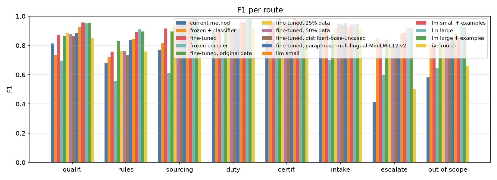
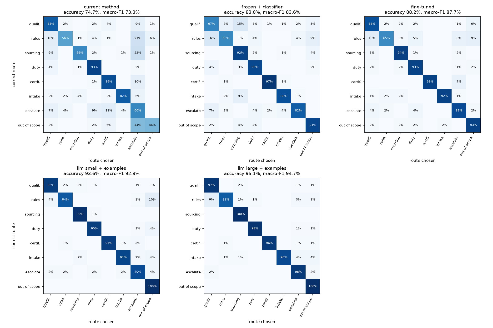
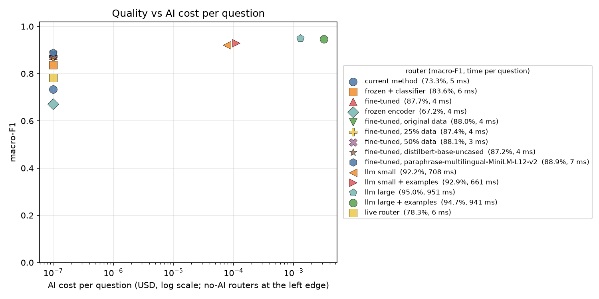

# Router comparison: TEST SETS (final run, once)

Question sets: holdout_seen, holdout_new, team_ai, team_hand, human_written. 95% confidence intervals from 1,000 bootstrap resamples; p-values from an exact McNemar test on the same questions.

## 1. Does training change the model?

The current router doesn't train anything: it compares each question with stored examples using the pretrained model as it was downloaded. The fine-tuned router changes the model's weights. The frozen version trains only the final layer, so its encoder is identical to the pretrained one (weight change 0). Because that version reads only the first token's output, which MiniLM wasn't trained to use, the comparison also includes 'frozen + classifier': the unchanged pretrained model's averaged word vectors with a simple classifier on top. That is the fair test of what fine-tuning adds.

**The live router is the untrained download.** Of the 62 weight tables the live router's model file stores at full precision, **62 are identical** to a fresh download of the pretrained model (largest difference 0.0). Fine-tuning would have changed them.

| Version | Training questions | Weights trained | Best epoch | New wording macro-F1 | New style macro-F1 | Training time |
|---|---|---|---|---|---|---|
| fine-tuned | 6,264 | 22,716,296 of 22,716,296 | 2 | 98.2% | 94.0% | 124 s |
| frozen encoder | 6,264 | 3,080 of 22,716,296 | 20 | 65.0% | 63.4% | 189 s |
| fine-tuned, original data | 1,577 | 22,716,296 of 22,716,296 | 6 | 91.6% | 82.5% | 40 s |
| fine-tuned, 25% data | 1,566 | 22,716,296 of 22,716,296 | 5 | 93.7% | 91.6% | 39 s |
| fine-tuned, 50% data | 3,132 | 22,716,296 of 22,716,296 | 6 | 93.6% | 93.4% | 62 s |
| fine-tuned, distilbert-base-uncased | 6,264 | 66,959,624 of 66,959,624 | 3 | 90.6% | 88.4% | 133 s |
| fine-tuned, paraphrase-multilingual-MiniLM-L12-v2 | 6,264 | 117,656,840 of 117,656,840 | 4 | 95.3% | 93.7% | 230 s |

Route separation in the model's sentence space (silhouette, 600 validation questions): **0.14 before fine-tuning → 0.74 after** (about 0 means the routes are mixed together; towards 1 means clean, separate groups).

## 2. Choosing the training settings (validation only)

Every combination of learning rate and batch size was trained, keeping each run's best epoch. The best combination (top row) is used for all the fine-tuned versions below.

| Learning rate | Batch size | Best epoch | New wording macro-F1 | New style macro-F1 | Mean | Training time |
|---|---|---|---|---|---|---|
| 5e-05 | 32 | 2 | 98.2% | 94.0% | **96.1%** | 129 s |
| 2e-05 | 16 | 3 | 97.7% | 93.4% | **95.5%** | 227 s |
| 5e-05 | 16 | 2 | 97.2% | 93.6% | **95.4%** | 228 s |
| 0.0001 | 32 | 5 | 96.8% | 92.3% | **94.5%** | 126 s |
| 2e-05 | 32 | 6 | 95.3% | 92.0% | **93.6%** | 81 s |
| 0.0001 | 16 | 2 | 95.0% | 91.8% | **93.4%** | 232 s |

## 3. How it changed during training (fine-tuned, chosen settings)

| Epoch | Training loss | New wording acc. | New wording macro-F1 | New style acc. | New style macro-F1 | Encoder weight change |
|---|---|---|---|---|---|---|
| 0 | – | 13.7% | 8.8% | 13.5% | 8.8% | 0.0000 |
| 1 | 1.3491 | 87.9% | 89.0% | 86.4% | 87.3% | 0.0214 |
| 2 | 0.1272 | 97.8% | 98.2% | 92.9% | 94.0% | 0.0265 |
| 3 | 0.0293 | 96.2% | 96.4% | 93.4% | 93.9% | 0.0276 |
| 4 | 0.013 | 95.0% | 95.0% | 92.8% | 93.3% | 0.0279 |
| 5 | 0.0091 | 96.5% | 96.8% | 93.1% | 93.7% | 0.0281 |
| 6 | 0.0075 | 95.6% | 95.8% | 93.2% | 93.6% | 0.0281 |

## 4. Comparison

| Router | Questions | Accuracy (95% CI) | Macro-F1 (95% CI) | Seconds per question | AI cost per question |
|---|---|---|---|---|---|
| current method | 653 | 74.7% (71.4%–77.9%) | 73.3% (69.7%–76.5%) | 0.0054 | $0.000000 |
| frozen + classifier | 653 | 83.0% (80.1%–85.9%) | 83.6% (80.5%–86.4%) | 0.0055 | $0.000000 |
| fine-tuned | 653 | 88.2% (85.6%–90.7%) | 87.7% (84.8%–90.0%) | 0.0036 | $0.000000 |
| frozen encoder | 653 | 68.3% (64.6%–71.7%) | 67.2% (63.1%–70.9%) | 0.0035 | $0.000000 |
| fine-tuned, original data | 653 | 88.4% (85.9%–90.5%) | 88.0% (85.5%–90.3%) | 0.0037 | $0.000000 |
| fine-tuned, 25% data | 653 | 88.4% (85.8%–90.7%) | 87.4% (84.4%–89.9%) | 0.0043 | $0.000000 |
| fine-tuned, 50% data | 653 | 88.7% (86.4%–91.1%) | 88.1% (85.5%–90.4%) | 0.0035 | $0.000000 |
| fine-tuned, distilbert-base-uncased | 653 | 88.2% (85.6%–90.7%) | 87.2% (84.5%–89.7%) | 0.0037 | $0.000000 |
| fine-tuned, paraphrase-multilingual-MiniLM-L12-v2 | 653 | 89.6% (87.0%–91.9%) | 88.9% (86.2%–91.1%) | 0.0066 | $0.000000 |
| llm small | 653 | 92.6% (90.5%–94.6%) | 92.2% (89.8%–94.1%) | 0.7082 | $0.000077 |
| llm small + examples | 653 | 93.6% (91.6%–95.4%) | 92.9% (90.6%–94.9%) | 0.6606 | $0.000110 |
| llm large | 653 | 95.3% (93.4%–96.9%) | 95.0% (93.1%–96.7%) | 0.9505 | $0.001289 |
| llm large + examples | 653 | 95.1% (93.3%–96.6%) | 94.7% (92.8%–96.4%) | 0.9409 | $0.003176 |
| live router | 653 | 79.8% (76.7%–82.7%) | 78.3% (74.8%–81.2%) | 0.0061 | $0.000000 |

### Is the fine-tuned router really different?

| fine-tuned vs | Questions | Only fine-tuned right | Only other right | p-value | Real difference? |
|---|---|---|---|---|---|
| current method | 653 | 102 | 14 | 0.0000 | yes (p < 0.05) |
| frozen + classifier | 653 | 54 | 20 | 0.0001 | yes (p < 0.05) |
| frozen encoder | 653 | 152 | 22 | 0.0000 | yes (p < 0.05) |
| fine-tuned, original data | 653 | 23 | 24 | 1.0000 | not shown |
| fine-tuned, 25% data | 653 | 14 | 15 | 1.0000 | not shown |
| fine-tuned, 50% data | 653 | 12 | 15 | 0.7011 | not shown |
| fine-tuned, distilbert-base-uncased | 653 | 23 | 23 | 1.0000 | not shown |
| fine-tuned, paraphrase-multilingual-MiniLM-L12-v2 | 653 | 27 | 36 | 0.3135 | not shown |
| llm small | 653 | 22 | 51 | 0.0009 | yes (p < 0.05) |
| llm small + examples | 653 | 16 | 51 | 0.0000 | yes (p < 0.05) |
| llm large | 653 | 13 | 59 | 0.0000 | yes (p < 0.05) |
| llm large + examples | 653 | 8 | 53 | 0.0000 | yes (p < 0.05) |
| live router | 653 | 77 | 22 | 0.0000 | yes (p < 0.05) |

### F1 per route

| Route | current method | frozen + classifier | fine-tuned | frozen encoder | fine-tuned, original data | fine-tuned, 25% data | fine-tuned, 50% data | fine-tuned, distilbert-base-uncased | fine-tuned, paraphrase-multilingual-MiniLM-L12-v2 | llm small | llm small + examples | llm large | llm large + examples | live router |
|---|---|---|---|---|---|---|---|---|---|---|---|---|---|---|
| qualification_check | 81.4% | 73.4% | 87.3% | 69.7% | 86.6% | 88.7% | 87.8% | 86.4% | 88.4% | 92.3% | 95.7% | 95.1% | 95.4% | 84.9% |
| rules_info | 67.7% | 72.3% | 75.8% | 55.7% | 83.0% | 76.3% | 75.9% | 73.4% | 83.8% | 84.4% | 89.0% | 91.0% | 89.5% | 75.8% |
| sourcing_whatif | 76.7% | 81.5% | 91.6% | 61.1% | 89.4% | 92.6% | 94.2% | 96.3% | 94.8% | 96.7% | 97.4% | 97.9% | 97.9% | 81.4% |
| duty_cost | 89.2% | 88.5% | 91.1% | 77.5% | 92.5% | 93.8% | 91.0% | 92.0% | 91.5% | 96.3% | 95.7% | 97.8% | 98.4% | 91.6% |
| certification_draft | 83.2% | 97.1% | 96.3% | 79.2% | 98.6% | 94.4% | 95.6% | 94.4% | 93.7% | 98.6% | 97.1% | 97.1% | 97.8% | 84.8% |
| document_intake | 88.6% | 90.3% | 95.5% | 70.1% | 87.9% | 91.6% | 94.4% | 94.3% | 95.5% | 92.3% | 94.2% | 94.3% | 94.7% | 91.4% |
| escalate_human | 41.6% | 85.2% | 82.0% | 60.0% | 83.8% | 79.3% | 80.0% | 78.9% | 79.6% | 88.1% | 88.5% | 92.0% | 91.5% | 50.3% |
| out_of_scope | 58.1% | 80.3% | 82.0% | 64.3% | 82.6% | 82.2% | 85.7% | 82.1% | 83.9% | 88.5% | 85.7% | 94.7% | 92.3% | 65.9% |

## 5. How much training data it needs

## 6. Economics

**A. Running cost per month** (what it costs to run the router itself)

| Router | Accuracy | Cost per question | 1,000/month | 100,000/month | 1,000,000/month |
|---|---|---|---|---|---|
| current method | 74.7% | $0.000000 | $0.00 | $0.00 | $0.00 |
| frozen + classifier | 83.0% | $0.000000 | $135.00 | $135.02 | $135.16 |
| fine-tuned | 88.2% | $0.000000 | $135.00 | $135.01 | $135.10 |
| frozen encoder | 68.3% | $0.000000 | $135.00 | $135.01 | $135.10 |
| fine-tuned, original data | 88.4% | $0.000000 | $135.00 | $135.01 | $135.11 |
| fine-tuned, 25% data | 88.4% | $0.000000 | $135.00 | $135.01 | $135.13 |
| fine-tuned, 50% data | 88.7% | $0.000000 | $135.00 | $135.01 | $135.10 |
| fine-tuned, distilbert-base-uncased | 88.2% | $0.000000 | $135.00 | $135.01 | $135.11 |
| fine-tuned, paraphrase-multilingual-MiniLM-L12-v2 | 89.6% | $0.000000 | $135.00 | $135.02 | $135.19 |
| llm small | 92.6% | $0.000077 | $0.08 | $7.73 | $77.32 |
| llm small + examples | 93.6% | $0.000110 | $0.11 | $10.96 | $109.57 |
| llm large | 95.3% | $0.001289 | $1.29 | $128.88 | $1,288.79 |
| llm large + examples | 95.1% | $0.003176 | $3.18 | $317.65 | $3,176.46 |
| live router | 79.8% | $0.000000 | $0.00 | $0.00 | $0.00 |

The fine-tuned routers have a fixed cost of about $135 a month whatever the volume: hosting ($15), 4 retrains a year and the one-time build (12 hours at $60) spread over 12 months. The prompted LLMs have no fixed cost, only a fee per question.

**B. Misrouted questions per month** (from each router's error rate on the validation questions)

| Router | Error rate | 1,000/month | 100,000/month | 1,000,000/month | Cost at $5.00 each, 100,000/month |
|---|---|---|---|---|---|
| current method | 25.3% | 253 | 25,268 | 252,680 | $126,340 |
| frozen + classifier | 17.0% | 170 | 16,998 | 169,985 | $84,992 |
| fine-tuned | 11.8% | 118 | 11,792 | 117,917 | $58,959 |
| frozen encoder | 31.7% | 317 | 31,700 | 316,998 | $158,499 |
| fine-tuned, original data | 11.6% | 116 | 11,639 | 116,386 | $58,193 |
| fine-tuned, 25% data | 11.6% | 116 | 11,639 | 116,386 | $58,193 |
| fine-tuned, 50% data | 11.3% | 113 | 11,332 | 113,323 | $56,662 |
| fine-tuned, distilbert-base-uncased | 11.8% | 118 | 11,792 | 117,917 | $58,959 |
| fine-tuned, paraphrase-multilingual-MiniLM-L12-v2 | 10.4% | 104 | 10,413 | 104,135 | $52,067 |
| llm small | 7.4% | 74 | 7,351 | 73,507 | $36,753 |
| llm small + examples | 6.4% | 64 | 6,432 | 64,319 | $32,159 |
| llm large | 4.7% | 47 | 4,747 | 47,473 | $23,737 |
| llm large + examples | 4.9% | 49 | 4,900 | 49,005 | $24,502 |
| live router | 20.2% | 202 | 20,214 | 202,144 | $101,072 |

A misroute sends the question to the wrong specialist, so someone has to redirect or re-ask it. Its cost ($5.00, about five minutes of staff time) is an assumption, not a measurement, and at high volume it outweighs the cost of running any router. These error rates are from the validation questions, which are deliberately hard (new wording and new writing styles); everyday questions may be easier.

**C. When fine-tuning pays off** (monthly questions above which the 'fine-tuned' router is cheaper)

| Against | Running cost only | Including misroutes at $0.50 | Including misroutes at $5.00 |
|---|---|---|---|
| llm small | about 1,748,416 | never | never |
| llm small + examples | about 1,233,218 | never | never |
| llm large | about 104,759 | never | never |
| llm large + examples | about 42,502 | never | never |

'Never' means the fine-tuned router is not cheaper per question at that setting, so no volume pays for its fixed costs: on running cost alone, because the LLM's fee is lower than the fine-tuned router's compute; with misroutes, because the LLM's higher accuracy saves more than its fee costs.
